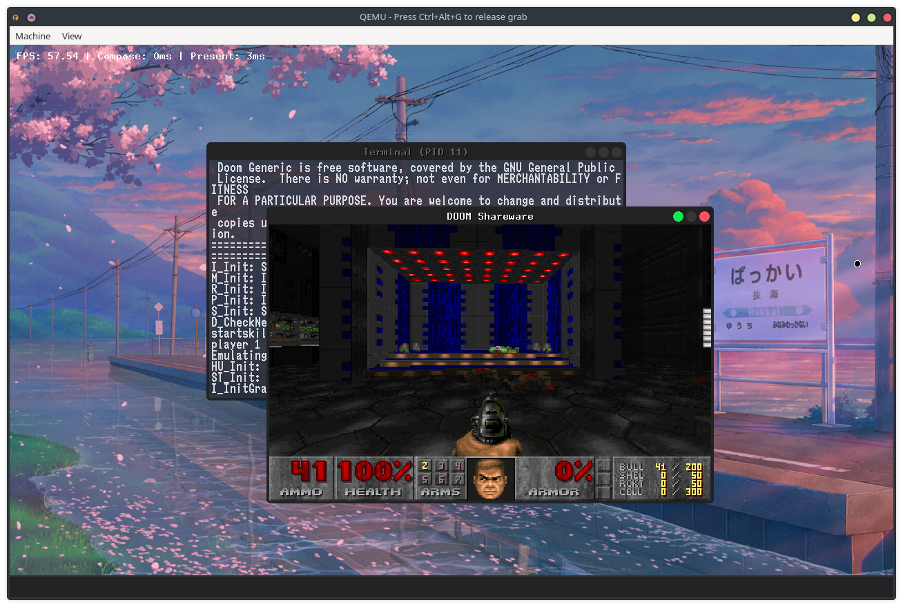
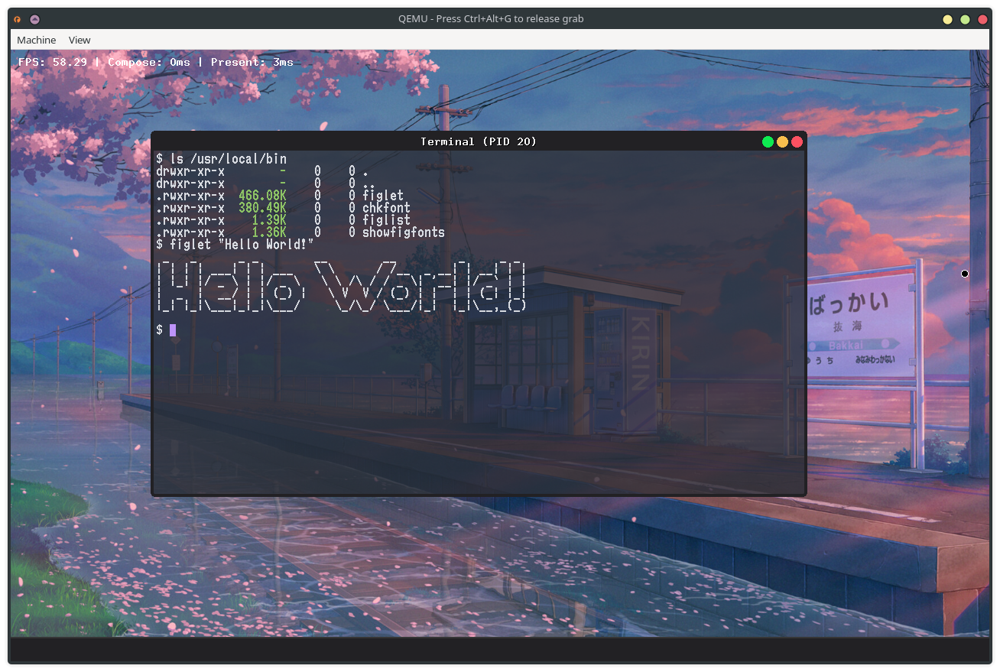

# Luxe

Luxe is an x86-64 microkernel-based operating system.

## Features:

- [X] Long mode, SMP, User/Kernel mode separation
- [X] Capability-based microkernel with a Unix-ish userspace
- [X] Synchronous and asynchronous IPC
- [X] User-mode drivers for various hardware devices such as:
    - PS2 Mouse/Keyboard
    - Intel HD Audio
    - AHCI (SATA drives)
    - XHCI (USB devices)
- [X] Custom libc and ports (currently have figlet & doomgeneric)
- [X] User-mode window manager

## Build instructions

TODO

- Required:
    - fuse2fs
    - mtools
    - parted
    - sgdisk
    - limine
    - clang

- Required for emulation:
    - qemu

- Required to build an ISO:
    - xorriso
    - tar

## Demo

- Luxe running [doomgeneric](https://github.com/ozkl/doomgeneric)

- Luxe running [figlet](https://www.figlet.org/)

